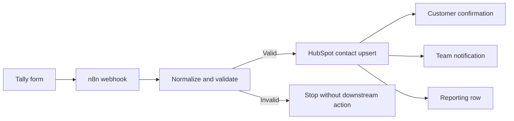

# Lead Capture → HubSpot CRM → Team Follow-Up

**An event-driven lead intake workflow that turns a form submission into a structured CRM contact and a coordinated follow-up handoff.**

**Type:** portfolio integration demo · **Stack:** n8n, Tally, HubSpot, Gmail, Slack, Google Sheets.

## Why it exists

Sales teams lose opportunities when lead data arrives in one tool but never reaches the CRM or the person responsible for responding. This project joins form capture, contact updates and team notification into one traceable workflow.

## What the repository contains

The importable n8n workflow is [`workflows/lead-capture-crm-sync.json`](workflows/lead-capture-crm-sync.json). A nontechnical setup guide is available at [`docs/setup-guide.pdf`](docs/setup-guide.pdf). The public export includes **eight nodes**: webhook, parsing/cleanup, validation, HubSpot upsert, Gmail response, Slack alert, sheet-row formatting and Google Sheets logging.

## Decisions worth highlighting

- **Normalize once.** Parse Tally fields by stable labels and standardize names/emails before writing to downstream services.
- **Use contact upsert semantics.** Repeated form submissions should update the correct CRM contact rather than generate unnecessary duplicate records.
- **Treat the CRM write as a separate milestone from notifications.** The team can only trust the handoff if the saved contact and notification outcomes are observable.
- **Keep failure paths explicit.** A production upgrade would add signature validation for inbound webhooks, durable event IDs, retry queues, dead-letter handling and a reconciliation report for partially completed downstream steps.

## What worked and what remains

The checked-in workflow expresses a complete **form-to-CRM-to-notification** design and contains a practical handover guide. The invalid-email output has no downstream handler. The three valid-path destinations can succeed or fail separately.

**Not verified by the public source alone:** a measured sub-10-second delivery SLA, zero lost leads, or a continuously running production environment. Those claims require redacted delivery logs and actual end-to-end acceptance tests.

## Reproduce

Import the JSON in n8n; connect Tally, HubSpot, Gmail, Slack and Google Sheets using your own authorized credentials; configure the HubSpot properties and sheet columns described in the setup guide; test valid/invalid submissions, duplicate addresses and provider failures without sending real prospect messages.

## Relevance to growth and CRM engineering

This project shows the connection between engineering quality and commercial outcomes: reliable intake, cleaner records, faster internal awareness and a better-defined lead follow-up process. It is a useful reusable integration pattern, not evidence of an independently measured revenue increase.

**Portfolio:** https://olawaleolaonipekun.vercel.app
